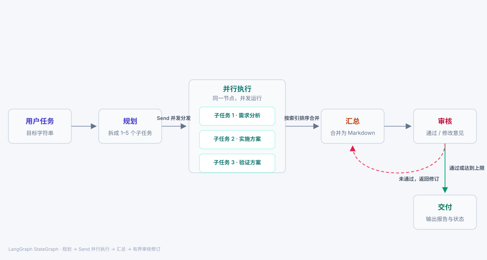
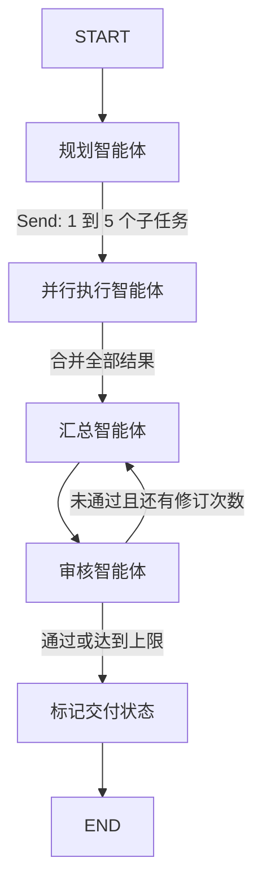

# Agentic · LangGraph 智能体编排

一个可以本地运行和扩展的 Python 项目，使用 LangGraph `StateGraph` 编排多个角色：规划、执行、汇总和审核。

**首次使用请看：[启动与项目介绍](docs/启动与项目介绍.md)**，包含 DeepSeek 配置、启动命令、流程说明和常见问题。

**使用 IntelliJ IDEA 请看：[IDEA 项目打开与配置指南（macOS / Windows）](docs/IDEA项目打开与配置指南.md)**，按系统分别说明环境准备、SDK / Python facet、目录标记和运行调试。

项目使用 DeepSeek，各角色实际调用模型。只需配置 `DEEPSEEK_API_KEY`，模型和地址已有默认值。

## Python 环境

当前系统的 Python 3.9.6 不满足 LangGraph 1.x 的 Python >=3.10 要求。本项目使用 pyenv 的 Python 3.12.16，版本记录在 `.python-version`，依赖安装在项目的 `.venv`。

本机首次配置时，源码下载较慢，因此使用 uv 下载预编译 CPython 3.12.16，并放入 `~/.pyenv/versions/3.12.16`，由 pyenv 按项目目录选择。以下命令也支持直接通过 pyenv 从源码安装同版本。

首次安装，或在其他电脑复现：

```bash
cd /Users/niyongzhe/Code/Ai/agentic
pyenv install -s 3.12.16
pyenv local 3.12.16
pyenv exec python -m venv .venv
.venv/bin/python -m pip install --upgrade pip
.venv/bin/python -m pip install -e '.[dev]'
```

若终端尚未初始化 pyenv，使用 `pyenv exec python` 或 `.venv/bin/python` 即可明确指定解释器。不要使用系统 Python 3.9 安装本项目。

## 立即运行

先复制配置并填写密钥：

```bash
cp .env.example .env
```

然后运行：

```bash
./start.sh run "设计一个企业知识库问答助手" --output output/report.md
```

也可以直接调用：

```bash
.venv/bin/agentic run "设计一个客服智能体" --output output/report.md
.venv/bin/python -m agentic run "设计一个客服智能体" --json
```

默认最大修订次数为 2，可用 `--max-revisions 0` 禁止修订，允许范围为 0–5。退出码 `0` 表示审核通过，`2` 表示达到修订上限但仍未通过（仍输出当前稿和审核意见），`1` 表示配置或执行失败。

## 使用 DeepSeek

```bash
cp .env.example .env
```

编辑 `.env`：

```dotenv
DEEPSEEK_API_KEY=你的DeepSeek密钥
DEEPSEEK_MODEL=deepseek-flash
DEEPSEEK_BASE_URL=https://api.deepseek.com
DEEPSEEK_TIMEOUT=120
```

在复制好的 `.env` 中填写密钥即可。模型和地址留空时也会使用上述默认值。默认模型名依据 [DeepSeek 当前官方文档](https://api-docs.deepseek.com/)；使用其他 DeepSeek 模型或第三方部署时，按服务商支持的名称和地址修改配置。

通过已有的 `langchain-openai` 适配 DeepSeek 的兼容接口，无需另外安装模型依赖。请求固定使用非思考模式，并通过 function calling 返回规划和审核的结构化结果，再由 Pydantic 校验。原因是 [DeepSeek 思考模式不支持指定工具的 `tool_choice`](https://api-docs.deepseek.com/api/create-chat-completion/)。

```bash
./start.sh run "为内部知识库设计问答助手，包含模块设计和验收标准" --output output/report.md
```

`start.sh` 会自动进入项目目录并使用 `.venv`，无需激活虚拟环境；从任意目录调用它都可以读取项目的 `.env`。直接调用 `agentic` 时，`.env` 从当前工作目录读取。已有 shell 环境变量优先；`.env` 已被 `.gitignore` 忽略。

真实模型调用会产生服务商费用。当前执行节点只做文本推理，不具备联网搜索、读写文件或执行代码的工具。项目未开启 LangSmith tracing。

## Web 服务

项目提供 FastAPI 可视化服务：在浏览器里输入任务目标，后台执行编排，完成后直接下载 Markdown 报告。

```bash
./start-web.sh
```

默认地址为 `http://127.0.0.1:8000`。需要换端口时：

```bash
PORT=8001 ./start-web.sh
```

主要接口：

| 方法 | 路径 | 用途 |
| --- | --- | --- |
| `GET` | `/` | 提问与下载页面 |
| `POST` | `/api/run` | 创建一次后台任务 |
| `GET` | `/api/task/{task_id}` | 查询进度和结果 |
| `GET` | `/api/task/{task_id}/download` | 下载最终 Markdown 报告 |

## Docker 容器化

项目提供 `Dockerfile`，构建后可直接运行 Web 服务。密钥通过 `--env-file` 注入，不会写进镜像：

```bash
docker build -t agentic .
docker run --rm -p 8000:8000 --env-file .env agentic
```

也可以只传入密钥：

```bash
docker run --rm -p 8000:8000 -e DEEPSEEK_API_KEY=你的密钥 agentic
```

打开 `http://127.0.0.1:8000` 即可使用。`.dockerignore` 已排除 `.venv`、`.env`、`output` 和测试文件。

## 编排流程



想跟着每一步的数据变化看动画，请打开[编排可视化讲解](docs/编排可视化讲解.html)：可自动播放，也可点击任意节点查看输入、输出和对应代码。



- `Send` 为每个子任务构造独立输入，worker 在同一轮并发执行。
- `Annotated[..., operator.add]` 合并并发结果；汇总前按任务索引排序。
- 审核通过条件与修订上限共同决定条件路由，避免无限循环。
- 模型调用设置超时和重试；节点失败时执行终止，不交付不完整结果。
- 状态保存在单次执行的内存中；跨进程恢复需要自行添加持久化 checkpointer。

输出 LangGraph 实际生成的 Mermaid 图：

```bash
.venv/bin/agentic graph
```

## 项目结构与扩展

```text
src/agentic/
  state.py     # 状态、子任务与审核的类型定义
  graph.py     # LangGraph 节点、并发分发、条件边
  backend.py   # Backend 协议、DeepSeek 适配
  cli.py       # 参数、环境变量、报告与 JSON 输出
tests/         # 并发汇合、审核路由、上限、失败与命令行测试
```

修改 `LLMBackend` 中各角色的提示词可以调整分工，`DeepSeekBackend` 提供 DeepSeek 默认配置。实现 `Backend` 协议可以替换模型服务或注入测试实现。需要加入搜索、数据库、业务 API 时，可以在 `work()` 中接入具体工具，或将 worker 替换成有工具调用循环的子图。

在 Python 中调用：

```python
from agentic import build_graph, initial_state
from agentic.backend import DeepSeekBackend

backend = DeepSeekBackend(api_key="你的DeepSeek密钥")
graph = build_graph(backend)
result = graph.invoke(initial_state("设计一个知识库助手"))
print(result["draft"])
print(result["status"])
```

## 开发与验证

```bash
make run
make test
make lint
```

测试使用本地响应，不需要密钥。覆盖真实并发汇合、审核通过、达到修订上限、节点异常、输入校验，以及 CLI JSON/文件输出。

依赖范围在 `pyproject.toml`；安装验证后生成的 `requirements.lock` 记录本次环境的具体版本。复现该依赖组合：

```bash
.venv/bin/python -m pip install -r requirements.lock
.venv/bin/python -m pip install --no-deps -e .
```

参考：[LangGraph 官方代码与版本要求](https://github.com/langchain-ai/langgraph/blob/main/libs/langgraph/pyproject.toml)、[官方编排模式文档](https://docs.langchain.com/oss/python/langgraph/workflows-agents)。
