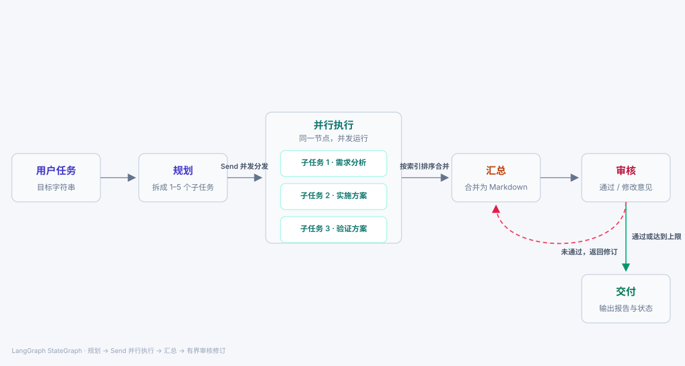
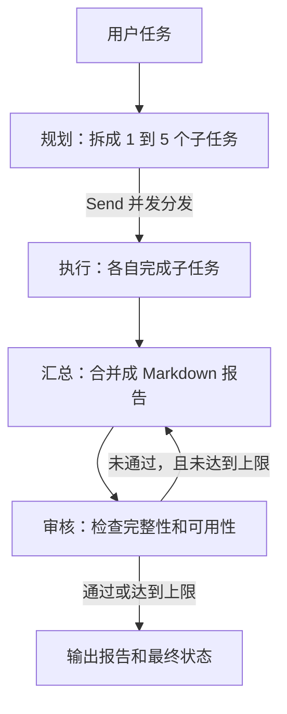

# LangGraph + DeepSeek：启动与项目介绍

## 1. 这个项目做什么

输入一个任务目标，例如“设计一个企业知识库问答助手”，程序让几个角色协作，最后生成一份 Markdown 报告。

LangGraph 负责决定节点的执行顺序、并发分发、共享状态和审核后的修订；DeepSeek 负责生成具体内容。各角色默认调用同一个 DeepSeek 模型，通过不同提示词分工。

目前这是一个命令行项目，执行完任务后退出；没有 Web 页面或常驻 HTTP 服务。执行节点做文本分析和方案生成，尚未接入联网搜索、文件读取或代码执行工具。

## 2. 本机最快启动方式

本机已有 Python 3.12.16 和项目 `.venv`，不需要重新安装。

### 第一步：配置密钥

```bash
cd /Users/niyongzhe/Code/Ai/agentic
cp -n .env.example .env
```

使用编辑器打开项目根目录的 `.env`，只需填入自己的 DeepSeek API Key：

```dotenv
DEEPSEEK_API_KEY=在这里填入你的DeepSeek密钥
DEEPSEEK_MODEL=deepseek-flash
DEEPSEEK_BASE_URL=https://api.deepseek.com
DEEPSEEK_TIMEOUT=120
```

密钥从 [DeepSeek 开放平台](https://platform.deepseek.com/) 获取。`.env` 已加入忽略规则。

### 第二步：运行任务

```bash
./start.sh run "设计一个企业知识库问答助手，包含模块设计、实施步骤和验收标准" --output output/report.md
```

程序会在终端打印结果，并保存到项目的 `output/report.md`。模型调用可能需要等待一段时间，当前终端在最终结果生成后输出完整报告。

`start.sh` 自动使用虚拟环境，也可以从任意位置运行：

```bash
/Users/niyongzhe/Code/Ai/agentic/start.sh run "帮我设计一个客服助手"
```

## 3. 配置项说明

| 配置 | 默认值 | 用途 |
| --- | --- | --- |
| `DEEPSEEK_API_KEY` | 无 | 必填 |
| `DEEPSEEK_MODEL` | `deepseek-flash` | 模型名称，可按实际服务修改 |
| `DEEPSEEK_BASE_URL` | `https://api.deepseek.com` | DeepSeek 官方接口地址 |
| `DEEPSEEK_TIMEOUT` | `120` | 单次模型请求超时秒数，必须大于 0 |

默认模型与地址来自 [DeepSeek 官方接入文档](https://api-docs.deepseek.com/)。如果使用第三方平台部署的 DeepSeek，请填写该平台的 API Key、兼容 Chat Completions 的地址和对应模型名称，且服务需支持 function calling。

编排中的规划和审核使用指定工具的结构化输出，因此所有 DeepSeek 请求固定发送 `thinking: {type: disabled}`。这与 [DeepSeek 接口对思考模式下 `tool_choice` 的限制](https://api-docs.deepseek.com/api/create-chat-completion/)一致。本项目暂未提供思考模式切换。

已有 shell 环境变量优先于 `.env`；修改 `.env` 后重新启动命令即可。

## 4. 常用命令

以下命令在项目根目录执行：

```bash
# 查看帮助
./start.sh
./start.sh run --help

# 使用 DeepSeek 并保存报告
./start.sh run "设计一个智能客服系统" --output output/customer-service.md

# 输出完整状态 JSON，方便其他程序读取
mkdir -p output
./start.sh run "设计一个知识库助手" --json > output/state.json

# 最多修订一次；0 表示只审核、不修订
./start.sh run "制定项目实施计划" --max-revisions 1

# 输出 Mermaid 流程图文本，无需密钥
./start.sh graph

# 运行测试与代码检查，无需密钥
make test
make lint
```

也可以运行 `make run`，或自定义任务：

```bash
make run GOAL="为公司设计一个文档检索助手"
```

## 4.1 以 Web 服务形式运行

浏览器中提问并下载报告：

```bash
./start-web.sh
```

打开 `http://127.0.0.1:8000`，填写任务目标后点击“开始生成”。页面会显示节点进度，完成后提供 Markdown 下载链接。换端口运行：

```bash
PORT=8001 ./start-web.sh
```

退出码含义：

| 退出码 | 含义 |
| --- | --- |
| `0` | 审核通过，状态 `approved` |
| `1` | 配置、接口调用或节点执行失败 |
| `2` | 达到修订上限仍未通过，状态 `revision_limit`；会输出当前稿及审核意见 |

## 5. 智能体如何协作



想跟着每一步的数据变化看动画，请打开[编排可视化讲解](编排可视化讲解.html)：可自动播放，也可点击节点查看输入、输出和对应代码位置。



| 角色 | 输入 | 输出 |
| --- | --- | --- |
| 规划 | 用户目标 | 结构化子任务列表 |
| 执行 | 用户目标及单个子任务 | 该子任务的文本结果 |
| 汇总 | 全部子任务结果、旧稿及审核意见 | Markdown 报告 |
| 审核 | 用户目标及当前报告 | 是否通过和具体修改意见 |

并行 worker 的结果先通过 reducer 合并，再按原始任务索引排序，交给汇总节点。审核未通过时只重做汇总与审核，不重新执行全部子任务。

一次无修订的任务通常调用模型 `子任务数 + 3` 次，每次修订额外调用 2 次；临时网络错误可能触发额外重试。默认最多修订 2 次。状态保存在单次执行的内存中，重新启动任务会从头执行。

## 6. 代码从哪里看

| 文件 | 主要职责 |
| --- | --- |
| `src/agentic/graph.py` | 定义图、并发分发与审核路由，建议先看这里 |
| `src/agentic/state.py` | 共享状态、任务列表和审核结果的类型 |
| `src/agentic/backend.py` | 角色提示词、DeepSeek 配置 |
| `src/agentic/cli.py` | 读取配置、执行任务、输出报告 |
| `.env.example` | 可复制的配置模板 |
| `start.sh` | 自动进入项目目录并使用虚拟环境启动 |
| `tests/` | 编排、CLI 和模拟模型接口测试 |

要改变角色能力，先修改 `backend.py` 中的提示词；要改变执行顺序或加入新节点，修改 `graph.py`。需要搜索、数据库、业务 API 或代码执行时，可从 worker 的 `work()` 实现扩展。

## 7. 新电脑或虚拟环境损坏时的安装步骤

```bash
cd /Users/niyongzhe/Code/Ai/agentic
pyenv install -s 3.12.16
pyenv local 3.12.16
pyenv exec python -m venv .venv
.venv/bin/python -m pip install -r requirements.lock
.venv/bin/python -m pip install --no-deps -e .
```

本项目使用 Python 3.12.16。系统 `python3 -V` 仍显示 3.9.6 时，可以直接使用 `start.sh`，它明确指定 `.venv/bin/python`。

## 8. 在 IntelliJ IDEA 中配置 Python

完整分步说明见：[IDEA 项目打开与配置指南（macOS / Windows）](IDEA项目打开与配置指南.md)。

| 系统 | IDEA 解释器 |
| --- | --- |
| 当前 macOS 项目 | `/Users/niyongzhe/Code/Ai/agentic/.venv/bin/python` |
| Windows 示例项目 | `D:\Code\agentic\.venv\Scripts\python.exe`，按实际项目目录修改 |

Python 模块直接配置 Python SDK；Java 模块需要添加 Python facet 并绑定该解释器。添加了 SDK 后，还需要将其应用到实际模块。`src` 标记为 Sources，`tests` 标记为 Test Sources。

Run/Debug 目标使用 **Module name: `agentic`**，Working directory 设为项目根目录。指南包含完整字段表、两套系统安装命令、DeepSeek 配置，以及 import 报错的排查步骤。

## 9. 常见问题

- **提示缺少 `DEEPSEEK_API_KEY`**：确认项目根目录有 `.env`，并且密钥不是空值。
- **鉴权或余额相关错误**：检查当前平台的密钥、账户权限与可用额度。使用第三方平台时，密钥和地址需来自同一平台。
- **模型不存在**：检查 `DEEPSEEK_MODEL` 是否为当前平台支持的名称。模型名称可在配置中直接修改。
- **连接失败或超时**：检查网络和 `DEEPSEEK_BASE_URL`，必要时增加 `DEEPSEEK_TIMEOUT`。
- **返回结构化输出或工具选择错误**：确认服务支持 function calling，且允许请求中的 `thinking` 扩展参数。本项目使用非思考模式。
- **出现 `revision_limit`**：查看审核意见，调整任务要求或在 0–5 范围内增加 `--max-revisions`；增加上限也会增加模型调用次数。
- **运行命令后暂时没有输出**：当前按整份报告输出，需要等待规划、并行任务、汇总和审核全部结束。按 `Ctrl+C` 可中断本次执行。

本地测试通过模拟 HTTP 响应验证 DeepSeek 请求地址、模型名、非思考参数和结构化结果解析，不会使用真实密钥。真实账户的网络、权限和模型可用性需要在填入密钥后验证。
