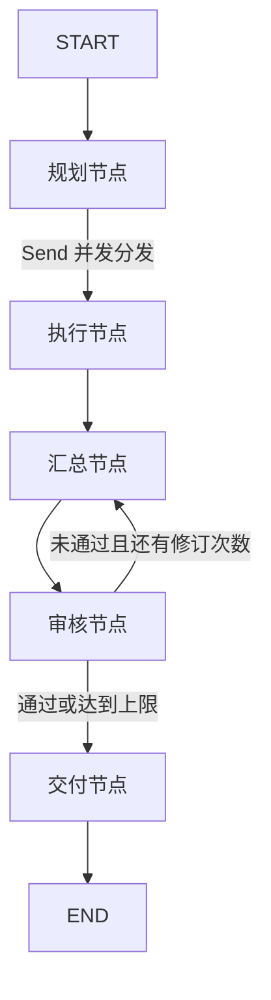
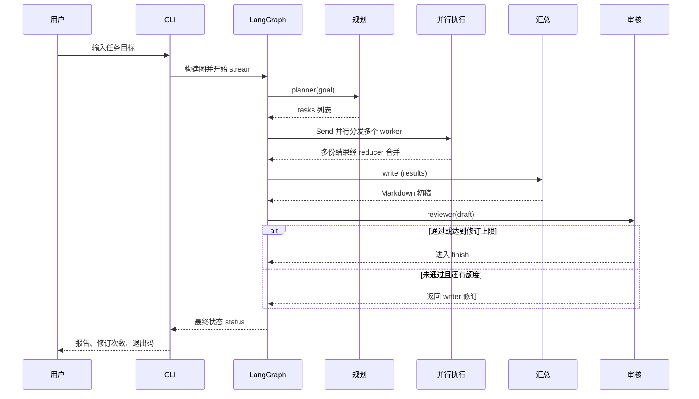

# LangGraph 多智能体编排：从零到可运行项目

> 面向有一定 Python 基础、但对 LangGraph 不太熟悉的同事。目标不是背 API，而是理解“为什么这样编排、每个角色在做什么、如何把一个文本模型变成一个可扩展的协作系统”。

## 1. 这次分享想讲清楚什么

完成这次分享后，希望听众能回答四个问题：

1. 单个大模型和多个智能体协作，本质区别在哪里？
2. LangGraph 的 `StateGraph`、节点、条件边和 `Send` 分别解决什么问题？
3. 这个项目里“规划 → 并行执行 → 汇总 → 审核修订”是怎么跑起来的？
4. 如果要把这个项目变成生产级工具，应该往哪个方向扩展？

建议现场准备：

- 一个已配置 DeepSeek 密钥、能执行 llm 命令的终端。
- 打开 [编排可视化讲解](编排可视化讲解.html)，跟着节点动画讲。

## 2. 为什么需要“编排”

一个模型一次回答，通常只能处理一条指令。但真实任务往往是：

- 先拆解目标；
- 再让不同角色分别完成子任务；
- 汇总成完整交付物；
- 最后有人检查并返工。

这就像一个团队，而不是一个全能员工。编排层负责安排“谁在什么时候做、数据如何流转、不通过时怎么办”，而模型只负责各自生成内容。

本项目把这条流水线拆成四个角色：

| 角色 | 职责 | 对应代码 |
| --- | --- | --- |
| 规划 | 把目标拆成 1–5 个可并行子任务 | `backend.py` 的 `plan()` |
| 执行 | 完成单个子任务 | `backend.py` 的 `work()` |
| 汇总 | 合并为 Markdown 报告 | `backend.py` 的 `write()` |
| 审核 | 判断是否通过并给出意见 | `backend.py` 的 `review()` |

角色之间的顺序、并行、分支由 LangGraph 管理，角色能力由提示词和模型决定。

## 3. LangGraph 的核心概念

LangGraph 把一次任务建模成一张**有向图**：



三个关键概念：

### 3.1 状态 State

图里流动的是一个共享状态对象。每个节点读取它、返回一小段“增量”，框架负责合并回全局状态。

本项目状态定义在 `src/agentic/state.py`：

```python
class WorkflowState(TypedDict, total=False):
    goal: str
    tasks: list[Task]
    results: Annotated[list[WorkerResult], operator.add]
    draft: str
    review: Review
    revisions: int
    max_revisions: int
    status: Literal["approved", "revision_limit"]
```

特别注意 `results` 的 `Annotated[..., operator.add]`。它叫 **reducer**，决定节点返回的新值如何并入旧值。并行 worker 各返回一段结果时，如果普通覆盖，后写的结果会把前面的冲掉；使用 `operator.add` 后，它们会追加成一个列表。

### 3.2 节点 Node

节点就是普通 Python 函数，输入当前状态，返回需要更新的字段。它不负责保存，也不直接调用下一个节点：

```python
def planner(state: WorkflowState):
    plan = Plan.model_validate(backend.plan(state["goal"]))
    return {"tasks": plan.tasks}
```

### 3.3 边 Edge

- 固定边：`A -> B`，执行完 A 一定去 B。
- 条件边：根据状态决定下一个节点，例如审核通过去交付，不通过回汇总。
- `Send`：动态生成一批并行任务，让同一个节点同时跑多份。

```python
def dispatch(state: WorkflowState):
    return [
        Send("worker", {"goal": state["goal"], "task": task, "index": index})
        for index, task in enumerate(state["tasks"])
    ]
```

`dispatch()` 不是节点，而是条件边生成器：它为每个子任务创建一个独立的 worker 输入。LangGraph 会并发执行这些 worker。

## 4. 项目结构速览

```text
src/agentic/
  state.py     # 状态、任务和审核的类型定义
  backend.py   # 角色能力：DeepSeek 适配
  graph.py     # LangGraph 节点、并行分发、审核路由
  cli.py       # 参数、环境变量、报告与进度输出
tests/         # 并发、审核路由、修订上限、失败和 CLI 测试
docs/          # 启动说明、IDEA 配置、可视化讲解
```

推荐阅读顺序：先看 `graph.py` 理解骨架，再看 `state.py` 理解数据，最后看 `backend.py` 理解模型怎么接入。

## 5. 一次任务的完整生命周期



真实模型模式：

```bash
./start.sh run "设计一个企业知识库问答助手" --output output/report.md
```

运行期间会打印节点进度；最终报告写入文件，`stdout` 输出报告、`stderr` 输出诊断信息，退出码 `0` 表示通过、`2` 表示达到修订上限。

## 6. 代码里最值得讲的三处

### 6.1 并发分发与结果合并

`graph.py` 中 planner 只产出任务，dispatch 负责分发：

```python
def dispatch(state: WorkflowState):
    return [
        Send("worker", {"goal": state["goal"], "task": task, "index": index})
        for index, task in enumerate(state["tasks"])
    ]
```

worker 返回单元素列表，reducer 自动合并；汇总前再按 `index` 排序，因为并行完成顺序不可控：

```python
sorted(state["results"], key=lambda r: r["index"])
```

### 6.2 有界审核修订

审核不通过时只回汇总，不重跑所有 worker，节省模型调用：

```python
def route_review(state: WorkflowState) -> Literal["writer", "finish"]:
    if state["review"].approved or state["revisions"] >= state.get("max_revisions", 2):
        return "finish"
    return "writer"
```

`revisions` 上限避免无限循环；默认最多修订 2 次，可在 0–5 之间调整。

### 6.3 模型与编排解耦

`backend.py` 定义 `Backend` 协议，`graph.py` 只依赖这四个方法：

```python
class Backend(Protocol):
    def plan(self, goal: str) -> Plan: ...
    def work(self, goal: str, task: Task) -> str: ...
    def write(self, goal: str, results: list[WorkerResult], draft: str, feedback: str) -> str: ...
    def review(self, goal: str, draft: str) -> Review: ...
```

这样测试注入本地实现，生产使用 `DeepSeekBackend`，甚至换成别的服务，都不需要改图结构。

## 7. DeepSeek 接入与结构化输出

DeepSeek 提供兼容 Chat Completions 的接口，因此复用 `langchain-openai` 的 `ChatOpenAI`，只改 `base_url` 和 `model`：

```python
self.model = ChatOpenAI(
    api_key=api_key,
    model=model,
    base_url=base_url,
    timeout=timeout,
    max_retries=2,
    use_responses_api=False,
)
```

规划和审核需要稳定的 JSON，所以绑定结构化输出：

```python
self.planner = self.model.with_structured_output(Plan, method="function_calling")
self.reviewer = self.model.with_structured_output(Review, method="function_calling")
```

DeepSeek 的思考模式不支持指定 `tool_choice`，而结构化输出依赖它，所以本项目固定关闭 thinking：

```python
extra_body = {"thinking": {"type": "disabled"}}
```

配置集中在 `.env`：

```dotenv
DEEPSEEK_API_KEY=你的密钥
DEEPSEEK_MODEL=deepseek-flash
DEEPSEEK_BASE_URL=https://api.deepseek.com
DEEPSEEK_TIMEOUT=120
```

## 8. 当前项目刻意保持的边界

讲到这里要提醒听众：这个项目是“文本方案生成器”，不是全自动机器人。

- worker 只做文本推理，没有联网搜索、文件读写或代码执行工具。
- 状态只存在单次内存里，重启就重新开始，没有持久化。
- 没有人工确认环节，审核完全由模型完成。
- 没有 LangSmith 等追踪平台，日志只在终端。

这些边界不是缺陷，而是为了让第一版足够简单、可测试、可理解。

## 9. 如果要继续扩展

按性价比排序，推荐路线如下：

1. **给 worker 加工具**：接入搜索 API、文件读取或代码执行器，让执行节点从“纯文本”变成“能行动”。
2. **持久化状态**：给 `graph.compile()` 传入 checkpointer，支持断点恢复和时间旅行调试。
3. **人工介入**：审核不通过或高风险动作前，挂起等待人工确认，再继续执行。
4. **可观测性**：配置 `LANGSMITH_*` 环境变量，查看每个节点的输入输出、耗时和 token。
5. **多模型策略**：规划用强模型、执行用便宜模型，根据子任务难度路由到不同模型。

扩展时尽量先改 `backend.py` 的能力，再改 `graph.py` 的拓扑，保持边界清晰。

## 10. 一句话总结

LangGraph 的价值不在“生成内容”，而在**把生成内容的过程变成显式、可测试、可扩展的状态图**。这个项目用最小的例子串起了拆解、并发、汇总、审核和修订，是理解多智能体编排的很好起点。

## 附录：现场演示命令

```bash
# 1. 查看流程图
./start.sh graph

# 2. 真实 DeepSeek 调用
./start.sh run "设计一个企业知识库问答助手" --output output/report.md

# 3. 限制修订次数，观察 revision_limit 退出码
./start.sh run "设计一个企业知识库问答助手" --max-revisions 0

# 4. 运行测试
make test
```

参考资料：

- [LangGraph 官方编排模式](https://docs.langchain.com/oss/python/langgraph/workflows-agents)
- [DeepSeek 开放平台](https://platform.deepseek.com/)
- [DeepSeek 官方接口文档](https://api-docs.deepseek.com/)
